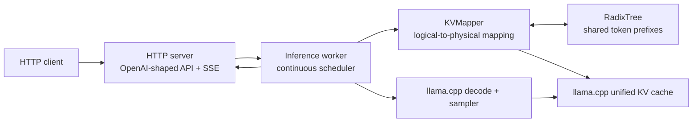

# RadixForge

A C++20 inference server that shares llama.cpp KV-cache prefixes across concurrent LLM requests.

RadixForge is an experimental, macOS-focused project for workloads whose prompts overlap: agent swarms, repeated system instructions, and multi-turn request families. It uses llama.cpp's unified KV cache and `llama_memory_seq_cp` to alias a cached prefix to a new sequence, then computes only the remaining prompt delta.

> **Status:** experimental. The cache lifecycle and HTTP behavior are covered by focused tests, but this is not yet a general-purpose production serving system.

## Quick start

Requirements: CMake 3.21+, a C++20 compiler, Git, a GGUF model, and llama.cpp checked out as the `vendor/llama.cpp` submodule. Metal acceleration is enabled by default on macOS.

```bash
git clone --recursive https://github.com/gioalvari/radixforge.git
cd radixforge

cmake -B build -S . -DCMAKE_BUILD_TYPE=Release
cmake --build build -j 5

./build/radixforge -m path/to/model.gguf --port 8400
```

Send a chat request:

```bash
curl http://127.0.0.1:8400/v1/chat/completions \
  -H 'Content-Type: application/json' \
  -d '{
    "messages": [{"role": "user", "content": "Explain radix trees in one sentence."}],
    "max_tokens": 64
  }'
```

## Architecture



### Request lifecycle

1. The HTTP server parses a prompt or chat messages and enqueues the request.
2. The worker tokenizes it, finds the longest matching radix prefix, and obtains a physical sequence ID.
3. For a cached prefix, `KVMapper` uses `llama_memory_seq_cp` to attach the prefix's KV cells to the new sequence.
4. The worker decodes the non-empty prompt delta, samples tokens, and streams or collects the response.
5. After a successful generation, the ready sequence is extended in the radix tree with the prompt plus generated tokens that were actually decoded into KV. The final sampled token is excluded when it was never fed back through a decode step.
6. On release, one ready sequence may be retained as a canonical cache; transient sequences are freed. Before preparation, the mapper evicts idle retained entries by LRU while its tracked KV-cell use exceeds `--kv-high-watermark × --ctx-size`.

The worker performs continuous batching: a decode step can contain generation tokens from active requests and prompt tokens from newly admitted requests, up to `--batch-size`.

## Correctness invariants

The cache lifecycle deliberately favors correct reuse over maximal reuse:

- **Ancestor-cap coverage:** a reusable source may cover only the canonical token length recorded for that tree node; a descendant's suffix is never treated as KV for another request unless the successful generation explicitly extended the tree to that suffix.
- **Non-empty delta:** for every non-empty prompt, preparation returns at least one token to decode. A complete prompt hit backs off one token rather than decoding into an already occupied KV position.
- **Canonical KV length:** `canonical_len` records tokens with valid KV, including generated tokens that were decoded and retained after a successful response. A final sampled-but-not-decoded token is not retained.
- **Ready-only copying:** a sequence becomes a copy source only after its prefill decode succeeds. Pending entries are never used as cache sources.
- **Safe eviction and pruning:** only unreferenced cache entries are evicted, whether under sequence-ID pressure or the mapper's KV high-watermark; empty leaf branches are pruned while logical internal prefixes remain available for future matching.

## Build and test

CMake options:

| Option | Default | Purpose |
| --- | --- | --- |
| `RADIXFORGE_METAL` | `ON` | Enable llama.cpp Metal acceleration on macOS. |
| `RADIXFORGE_BUILD_TESTS` | `ON` | Build and register unit tests. |
| `RADIXFORGE_BUILD_TOOLS` | `ON` | Build standalone research tools. |
| `RADIXFORGE_UNIT_TESTS_ONLY` | `OFF` | Build only the unit tests, without compiling llama.cpp or the server. |
| `RADIXFORGE_WERROR` | `OFF` | Treat project warnings (`-Wall -Wextra -Wpedantic`) as errors. CI enables it. |
| `RADIXFORGE_SANITIZE` | empty | Sanitizers for project targets: `address,undefined` or `thread`. |
| `RADIXFORGE_E2E_MODEL` | empty | Path to a GGUF model; when set, registers the end-to-end determinism test. |

```bash
cmake -B build -S . -DCMAKE_BUILD_TYPE=Release
cmake --build build -j 5
ctest --test-dir build --output-on-failure
```

Tests:

- `test_radix_tree`: radix-tree unit tests, including the ancestor-cap and leaf-pruning regressions and a concurrency stress test.
- `test_kv_mapper`: `KVMapper` lifecycle tests against a fake `KvOps`, with no model needed (sequence-ID accounting, full-hit delta, trimming, multi-turn extension).
- `e2e_determinism`: starts the server and checks that temperature-0 output for a prompt is the same cold, after sibling prompts, on a repeat, and after eviction.

Fast unit-test loop with sanitizers (no llama.cpp build):

```bash
cmake -B build-asan -S . -DRADIXFORGE_UNIT_TESTS_ONLY=ON -DRADIXFORGE_SANITIZE=address,undefined
cmake --build build-asan -j 5 && ctest --test-dir build-asan --output-on-failure
```

End-to-end test with a tiny model:

```bash
curl -L -o /tmp/stories260K.gguf \
  https://huggingface.co/ggml-org/models/resolve/main/tinyllamas/stories260K.gguf
cmake -B build -S . -DCMAKE_BUILD_TYPE=Release -DRADIXFORGE_E2E_MODEL=/tmp/stories260K.gguf
cmake --build build -j 5 && ctest --test-dir build --output-on-failure
```

CI (GitHub Actions) runs the full macOS build and tests with ccache, Linux unit tests under ASan+UBSan and under TSan, a lint job (clang-format 18 and ruff), and the e2e determinism test on macOS against a tiny GGUF model. All jobs are blocking.

## Server configuration

| Flag | Default | Description |
| --- | ---: | --- |
| `-m`, `--model <path>` | required | GGUF model path. |
| `-c`, `--ctx-size <n>` | `32768` | Context/KV-cache size in tokens. |
| `-b`, `--batch-size <n>` | `2048` | Maximum tokens submitted in a fused decode batch. |
| `-ngl`, `--n-gpu-layers <n>` | `99` | Number of layers passed to llama.cpp for GPU offload. |
| `--host <addr>` | `127.0.0.1` | Bind address. |
| `--port <n>` | `8400` | Bind port. |
| `--max-seq <n>` | `32` | Maximum llama.cpp sequence IDs. |
| `--admit-window-ms <n>` | `2` | Idle coalescing window for request bursts; `0` disables the wait. |
| `--request-timeout <seconds>` | `300` | Non-streaming response timeout; values are clamped to at least one second. |
| `--kv-high-watermark <0..1>` | `0.9` | Before preparation, LRU-evict idle retained sequences while mapper-tracked KV cells exceed this fraction of `--ctx-size`. Values must be greater than `0` and at most `1`. |
| `--admin-token <token>` | unset | Optional Bearer token required for `/admin/*`. |
| `--log-level <level>` | `info` | `debug`, `info`, `warn`, or `error`. |

## HTTP API

The server accepts JSON at these endpoints:

| Endpoint | Behavior |
| --- | --- |
| `GET /health` | Returns server status, model basename, active/pending counts, and cache-hit rate. |
| `GET /metrics` | Returns Prometheus text-format counters and gauges. |
| `GET /admin/stats` | Returns worker and cache counters; requires `Authorization: Bearer <token>` when `--admin-token` is set. |
| `GET /admin/tree/dump` | Returns radix-tree diagnostics; same optional admin authorization. |
| `POST /v1/chat/completions` | Chat-shaped response with `choices[].message`. |
| `POST /v1/completions` | Text-completion-shaped response with `object: "text_completion"` and `choices[].text`. |

Request bodies accept either `messages` (an array of `{role, content}` objects) or a string `prompt`, plus optional `max_tokens`, `temperature`, `top_p`, and `stream`.

### Prometheus metrics

`GET /metrics` is unauthenticated and returns `text/plain; version=0.0.4`. It exposes request, prompt-token, cache-hit-token, and eviction counters, plus sequence, KV-cell, and tree-node gauges:

```text
# TYPE radixforge_requests_total counter
radixforge_requests_total 42
# TYPE radixforge_cache_hit_tokens_total counter
radixforge_cache_hit_tokens_total 768
# TYPE radixforge_kv_cells_used gauge
radixforge_kv_cells_used 1024
```

The complete metric set is `radixforge_requests_total`, `radixforge_cache_hit_tokens_total`, `radixforge_prompt_tokens_total`, `radixforge_evictions_total`, `radixforge_active_sequences`, `radixforge_retained_sequences`, `radixforge_kv_cells_used`, and `radixforge_tree_nodes`. `radixforge_kv_cells_used` is mapper-tracked per-sequence valid-KV accounting, not a direct occupancy reading from llama.cpp.

### Multi-turn reuse

Successful decoded output extends the reusable radix prefix. In a deterministic smoke check with Qwen2.5-0.5B-Instruct Q4_K_M at temperature 0, the first-turn prompt had 16 tokens; the second-turn prompt had 35 tokens and reused 18 cache-hit tokens, including generated answer tokens. The second-turn output matched a cold run after restart. This is a single smoke observation, not a performance benchmark.

### Validation and errors

- `max_tokens` must be a finite, non-negative integer representable as `int32_t`; malformed values return HTTP 400.
- The minimal JSON parser rejects nesting deeper than 64 levels and rejects trailing non-whitespace input.
- Non-streaming errors use an OpenAI-style envelope:

  ```json
  {"error":{"message":"...","type":"invalid_request_error"}}
  ```

  Invalid requests return 400, exhausted KV capacity returns 503, internal inference failures return 500, and a non-streaming timeout returns 504.
- Streaming requests send `text/event-stream`. If an error happens after headers are sent, the server emits `data: {"error": ...}` followed by `data: [DONE]`. Normal streams end with a final choice containing `finish_reason: "stop"` and then `[DONE]`.
- Streaming buffers an incomplete trailing UTF-8 sequence so a multi-byte code point is not split across SSE content chunks.

## Limitations

- The project is tested on macOS with the llama.cpp Metal path; other platforms/backends are not validated here.
- It serves one model per process and has one inference worker. Run separate processes for separate models.
- The API is intentionally small: it does not implement authentication for `/v1/*`, tools/function calling, embeddings, logprobs, grammar controls, or the complete OpenAI API surface.
- Output quality, memory use, and throughput depend on the selected GGUF model and llama.cpp version. A current, single-machine shared-prefix measurement is documented in [docs/benchmark.md](docs/benchmark.md); it is not a general performance claim.
- KV high-watermark accounting is maintained by `KVMapper` from valid cells assigned to each sequence; it is not a direct llama.cpp memory-occupancy measurement. Active or referenced sequences cannot be evicted to satisfy the watermark.
- The parser is deliberately minimal and intended only for the supported request schema.

## Research spikes

These experiments are separate from the inference server and are **not integrated** into its request path:

- [Position-independent KV chunk reuse](docs/chunk-kv-spike.md)
- [Cross-request speculative drafting](docs/spec-study.md)
- [MoE expert-routing residency](docs/moe-study.md)

A historical benchmark report predating the cache-hardening changes is retained for context in [docs/history/benchmark-2026.md](docs/history/benchmark-2026.md). Its results and claims should not be used to characterize the current server.

## Project layout

```text
include/radixforge/  Public headers, cache abstractions, and configuration
src/                 Worker/scheduler, HTTP transport, API formatting, cache/tree code
test/                RadixTree and KVMapper unit tests
tools/               Standalone feasibility and tracing tools
scripts/             Research helpers
docs/                Research notes and historical reports
vendor/llama.cpp/    Pinned llama.cpp submodule
```

## License

MIT — see [LICENSE](LICENSE).
