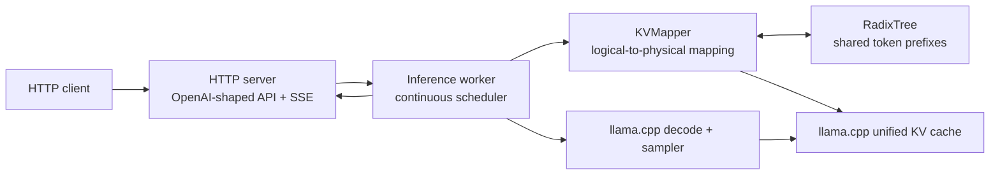

# RadixForge

A C++20 inference server that shares llama.cpp KV-cache prefixes across concurrent LLM requests.

RadixForge is an experimental, macOS-focused project for workloads whose prompts overlap: agent swarms, repeated system instructions, and multi-turn request families. It uses llama.cpp's unified KV cache and `llama_memory_seq_cp` to alias a cached prefix to a new sequence, then computes only the remaining prompt delta.

> **Status:** experimental. The cache lifecycle and HTTP behavior are covered by focused tests, but this is not yet a general-purpose production serving system.

## Quick start

Requirements: CMake 3.21+, a C++20 compiler, Git, a GGUF model, and llama.cpp checked out as the `vendor/llama.cpp` submodule. Metal acceleration is enabled by default on macOS.

```bash
git clone --recursive https://github.com/gioalvari/radixforge.git
cd radixforge

cmake -B build -S . -DCMAKE_BUILD_TYPE=Release
cmake --build build -j 5

./build/radixforge -m path/to/model.gguf --port 8400
```

Send a chat request:

```bash
curl http://127.0.0.1:8400/v1/chat/completions \
  -H 'Content-Type: application/json' \
  -d '{
    "messages": [{"role": "user", "content": "Explain radix trees in one sentence."}],
    "max_tokens": 64
  }'
```

## Architecture



### Request lifecycle

1. The HTTP server parses a prompt or chat messages and enqueues the request.
2. The worker tokenizes it, finds the longest matching radix prefix, and obtains a physical sequence ID.
3. For a cached prefix, `KVMapper` uses `llama_memory_seq_cp` to attach the prefix's KV cells to the new sequence.
4. The worker decodes the non-empty prompt delta, samples tokens, and streams or collects the response.
5. On completion, the sequence is released. One ready sequence may be retained as a canonical prompt cache; transient sequences are freed. Idle retained entries are eligible for LRU eviction.

The worker performs continuous batching: a decode step can contain generation tokens from active requests and prompt tokens from newly admitted requests, up to `--batch-size`.

## Correctness invariants

The cache lifecycle deliberately favors correct reuse over maximal reuse:

- **Ancestor-cap coverage:** a reusable source may cover only the canonical token length recorded for that tree node; a descendant's generated suffix is never treated as prompt KV for another request.
- **Non-empty delta:** for every non-empty prompt, preparation returns at least one token to decode. A complete prompt hit backs off one token rather than decoding into an already occupied KV position.
- **Canonical trimming:** when the retained canonical sequence finishes generating, generated KV cells are removed beyond its `canonical_len` before it is reused.
- **Ready-only copying:** a sequence becomes a copy source only after its prefill decode succeeds. Pending entries are never used as cache sources.
- **Safe eviction and pruning:** only unreferenced cache entries are evicted; empty leaf branches are pruned while logical internal prefixes remain available for future matching.

## Build and test

CMake options:

| Option | Default | Purpose |
| --- | --- | --- |
| `RADIXFORGE_METAL` | `ON` | Enable llama.cpp Metal acceleration on macOS. |
| `RADIXFORGE_BUILD_TESTS` | `ON` | Build and register unit tests. |
| `RADIXFORGE_BUILD_TOOLS` | `ON` | Build standalone research tools. |

```bash
cmake -B build -S . -DCMAKE_BUILD_TYPE=Release
cmake --build build -j 5
ctest --test-dir build --output-on-failure
```

The test suite includes radix-tree unit tests and `KVMapper` lifecycle tests using the `KvOps` test abstraction. Run the commands above locally before changing cache behavior.

## Server configuration

| Flag | Default | Description |
| --- | ---: | --- |
| `-m`, `--model <path>` | required | GGUF model path. |
| `-c`, `--ctx-size <n>` | `32768` | Context/KV-cache size in tokens. |
| `-b`, `--batch-size <n>` | `2048` | Maximum tokens submitted in a fused decode batch. |
| `-ngl`, `--n-gpu-layers <n>` | `99` | Number of layers passed to llama.cpp for GPU offload. |
| `--host <addr>` | `127.0.0.1` | Bind address. |
| `--port <n>` | `8400` | Bind port. |
| `--max-seq <n>` | `32` | Maximum llama.cpp sequence IDs. |
| `--admit-window-ms <n>` | `2` | Idle coalescing window for request bursts; `0` disables the wait. |
| `--request-timeout <seconds>` | `300` | Non-streaming response timeout; values are clamped to at least one second. |
| `--admin-token <token>` | unset | Optional Bearer token required for `/admin/*`. |
| `--log-level <level>` | `info` | `debug`, `info`, `warn`, or `error`. |

## HTTP API

The server accepts JSON at these endpoints:

| Endpoint | Behavior |
| --- | --- |
| `GET /health` | Returns server status, model basename, active/pending counts, and cache-hit rate. |
| `GET /admin/stats` | Returns worker and cache counters; requires `Authorization: Bearer <token>` when `--admin-token` is set. |
| `GET /admin/tree/dump` | Returns radix-tree diagnostics; same optional admin authorization. |
| `POST /v1/chat/completions` | Chat-shaped response with `choices[].message`. |
| `POST /v1/completions` | Text-completion-shaped response with `object: "text_completion"` and `choices[].text`. |

Request bodies accept either `messages` (an array of `{role, content}` objects) or a string `prompt`, plus optional `max_tokens`, `temperature`, `top_p`, and `stream`.

### Validation and errors

- `max_tokens` must be a finite, non-negative integer representable as `int32_t`; malformed values return HTTP 400.
- The minimal JSON parser rejects nesting deeper than 64 levels and rejects trailing non-whitespace input.
- Non-streaming errors use an OpenAI-style envelope:

  ```json
  {"error":{"message":"...","type":"invalid_request_error"}}
  ```

  Invalid requests return 400, exhausted KV capacity returns 503, internal inference failures return 500, and a non-streaming timeout returns 504.
- Streaming requests send `text/event-stream`. If an error happens after headers are sent, the server emits `data: {"error": ...}` followed by `data: [DONE]`. Normal streams end with a final choice containing `finish_reason: "stop"` and then `[DONE]`.
- Streaming buffers an incomplete trailing UTF-8 sequence so a multi-byte code point is not split across SSE content chunks.

## Limitations

- The project is tested on macOS with the llama.cpp Metal path; other platforms/backends are not validated here.
- It serves one model per process and has one inference worker. Run separate processes for separate models.
- The API is intentionally small: it does not implement authentication for `/v1/*`, tools/function calling, embeddings, logprobs, grammar controls, or the complete OpenAI API surface.
- Output quality, memory use, and throughput depend on the selected GGUF model and llama.cpp version. No current benchmark is presented as a general performance claim.
- The parser is deliberately minimal and intended only for the supported request schema.

## Research spikes

These experiments are separate from the inference server and are **not integrated** into its request path:

- [Position-independent KV chunk reuse](docs/chunk-kv-spike.md)
- [Cross-request speculative drafting](docs/spec-study.md)
- [MoE expert-routing residency](docs/moe-study.md)

A historical benchmark report predating the cache-hardening changes is retained for context in [docs/history/benchmark-2026.md](docs/history/benchmark-2026.md). Its results and claims should not be used to characterize the current server.

## Project layout

```text
include/radixforge/  Public headers, cache abstractions, and configuration
src/                 Worker/scheduler, HTTP transport, API formatting, cache/tree code
test/                RadixTree and KVMapper unit tests
tools/               Standalone feasibility and tracing tools
scripts/             Research helpers
docs/                Research notes and historical reports
vendor/llama.cpp/    Pinned llama.cpp submodule
```

## License

MIT — see [LICENSE](LICENSE).
